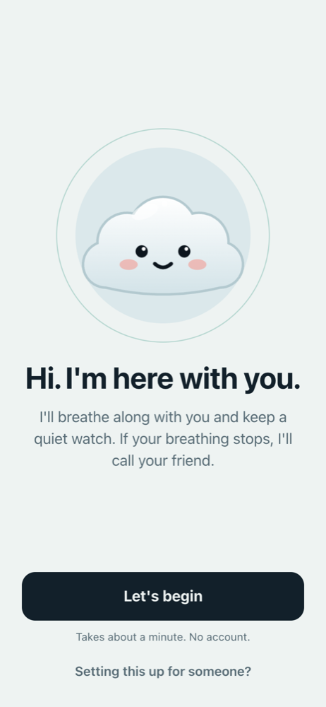
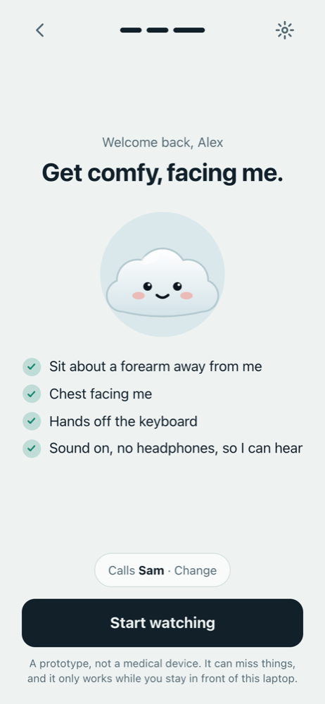
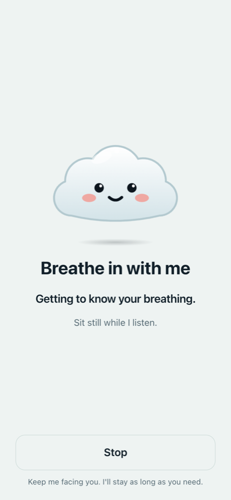
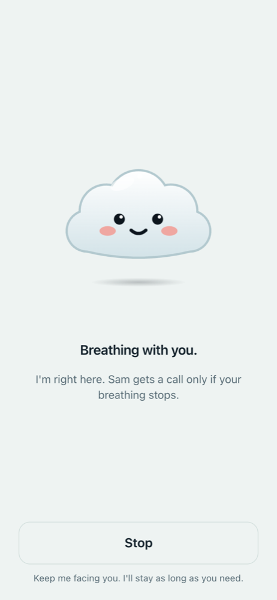
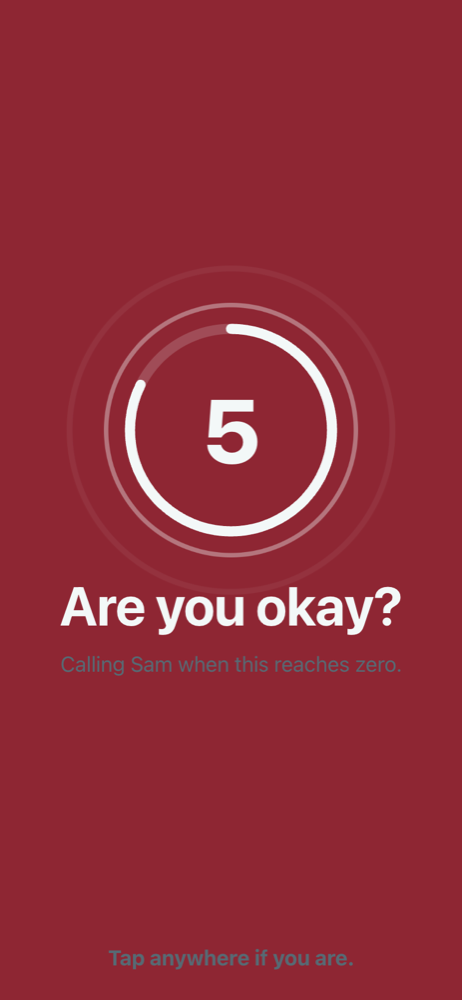
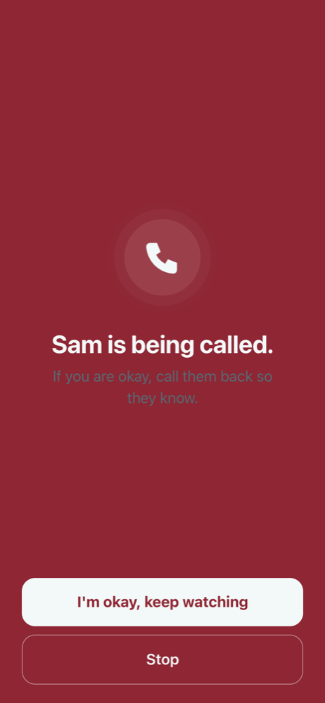
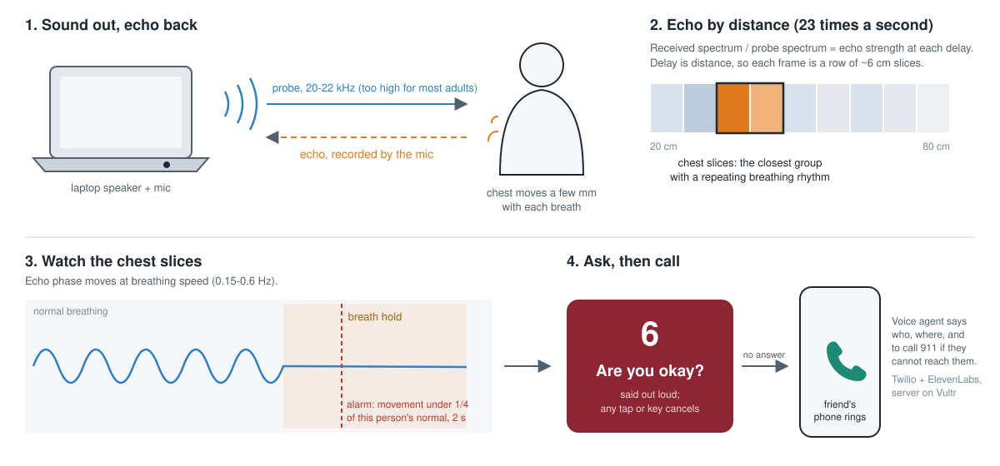
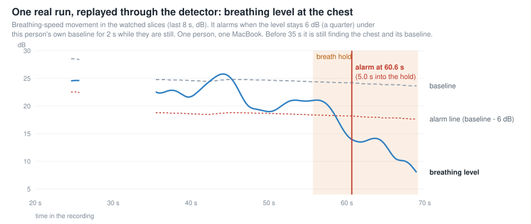
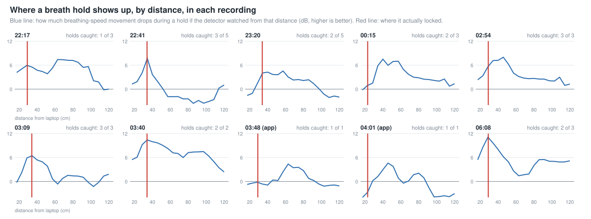
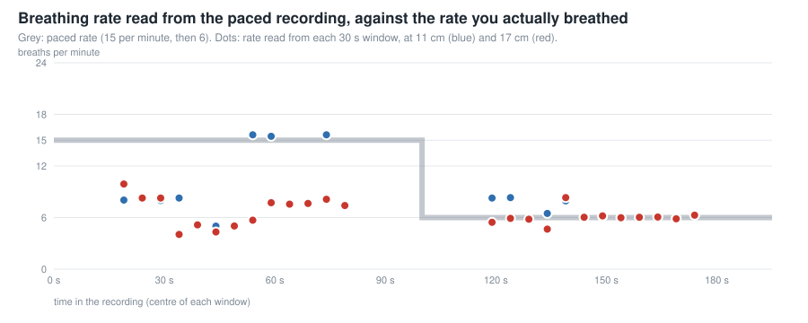

# BreathBuddy

A web page that uses your laptop's speaker and mic to listen for your breathing, and phones a friend if it stops.

**Live app: https://breathbuddy.us/app/** (works in Chrome on a laptop; nothing to install)



Built by one student at SanD Hacks 2026 (UC San Diego, Nov 14-15 2026). A prototype, not a medical device.

## Why

About 75.5% of US overdose deaths in 2022-2024 happened with no one else present (CDC SUDORS 2022-2024, 191,577 deaths). An overdose slows breathing and then stops it. If no one is there, no one can give naloxone or call 911. BreathBuddy builds on the University of Washington "Second Chance" project (2019), a phone sonar app for the same problem.

## How it works

| 1. Set up | 2. Breathe with the cloud | 3. Watching | 4. Breathing stops | 5. Friend is called |
|---|---|---|---|---|
|  |  |  |  |  |
| A friend sets it up on their phone and texts a personal link. The person opens it on a laptop and presses Start. | They breathe with the cloud for about 26 seconds while the app finds their chest. | Then it watches. | If breathing-speed chest movement drops to a quarter of that person's normal level for 2 seconds while they are still, it asks "Are you okay?" out loud. 6 second countdown; any tap or key cancels. | If nobody answers, a voice agent phones the friend: who it is about, that their breathing appears to have stopped, where they are, and to call 911 if they cannot reach them. The friend can ask it questions. |

(Screenshots from the app's dev mode with a fake sonar and a made-up contact. No call was placed.)



1. **Sound out, echo back.** The laptop speaker plays a repeating 20-22 kHz probe, too high for most adults to hear (a 2048-sample Schroeder-phase multi-tone). The mic records the echoes.
2. **Echo by distance.** Dividing the received spectrum by the probe's gives echo strength by delay, which means by distance, in slices of about 6 cm, 23 times a second.
3. **Find the chest.** A breathing chest moves a few millimetres. That shifts the phase of its echo at 0.15-0.6 Hz. The app picks the closest group of slices within 80 cm that has a repeating breathing rhythm.
4. **Watch for a stop.** It compares breathing-band movement there (last 8 s) with the person's own baseline. A drop to a quarter for 2 s while still raises the alarm.
5. **Call.** A small Python server (`call/server.py`, standard library only) on a Vultr machine places the call with Twilio and an ElevenLabs conversational voice agent.

Other details:
- Probe loudness sets itself: it starts quiet and steps up only until the mic hears the probe clearly.
- If the mic cannot hear the probe (speaker muted), the app says so instead of pretending to watch.
- All signal processing is plain JavaScript in the browser (`dsp.js`, Web Audio AudioWorklet). No ML model. No audio leaves the device, only the call request.
- The static app is hosted on GitHub Pages at breathbuddy.us and installs to the home screen.

## Does it work?

What I measured, with its limits:

- **Live in the app over two days (Nov 15-16): all 29 runs where I held my breath raised the alarm, and 22 went on to place the call.** In the other 7, the countdown was cancelled or the run was stopped before the call. In one run I held twice and the second hold was missed, which led to a fix (the alarm now fires on a replay of it). Where a hold was marked, the alarm came 5 to 12 seconds into it. Most holds were not marked with times, so this count is from my notes of each run, not a timed test. One person, one MacBook, a quiet room, deliberate breath holds.
- **A second person on their own MacBook: it worked as intended.** Their breath holds raised the alarm. This is what they reported; I have no recording or count from that run, so it is not in the counts above.
- **Replay of older labelled recordings that include moving and fidgeting: 23 of 29 holds caught, 12 false alarms.** Same person and laptop. I adjusted the detector on these same recordings, so this is not a held-out result.
- **Lock-on takes about 26 seconds.** Movement makes it start over.

One real run, replayed through the same detector code. The level falls during the hold and the alarm fires 5 s in:



Where a breath hold shows up by distance (blue: how much the breathing level drops during holds if the detector watched from that distance) and where the detector actually locked (red), in each recording. In several recordings the lock is not where the hold shows most (for example 00:15, and the two app runs at 03:48 and 04:01, which still caught their one hold each). This chart was made with an older version that searched out to 120 cm.



Breathing rate does **not** work yet. On a recording where I breathed at a paced 15 and then 6 breaths per minute, the rate read during the 15 per minute part was mostly 4-10, with a few readings near 15. It could not tell the two rates apart reliably.



I also built a simulator calibrated from these recordings (`tools/fit`, write-up in [docs/sim/README.md](docs/sim/README.md)). It does not yet reproduce the detector well enough to quote accuracy from, so no simulated numbers are given here.

## Limits

- Prototype, not a medical device. Never tested on a real overdose or during sleep.
- Measured on one person and one laptop; one more person checked it on their own MacBook.
- Cannot read breathing rate reliably, so it cannot catch breathing that is only slowing.
- Phones cut the probe band. An 18-20 kHz option (`app/?band=18`) exists but is unproven.
- A person or pet breathing closer than the user can be picked instead.
- Lock-on takes about 26 seconds, and movement makes it start over.

## Run it

**Hosted:** open https://breathbuddy.us/app/ in Chrome on a laptop. Allow the mic. Sound on, no headphones. On macOS set Control Center > Mic Mode to Standard. Sit about a forearm (30-40 cm) from the laptop.

**Locally, with the call:** double-click `Start Demo.command`. It starts the call server and a web server and opens the app in Chrome. Close its window to stop both. By hand:

1. **Call server.** Make a `.env` file in the repo root (it is gitignored):
   ```
   TWILIO_ACCOUNT_SID=...
   TWILIO_AUTH_TOKEN=...
   TWILIO_NUMBER=+1...
   ELEVENLABS_API_KEY=...
   ```
   Then `python3 call/server.py` (standard library only). It listens on `http://127.0.0.1:8788` and the app posts to `/call`. The first run registers the Twilio number with ElevenLabs, creates the voice agent and saves their ids in `call/state.json`. Test a call by itself: `python3 call/server.py --test +16195550123 --name Sam --user Alex --place "the library"`. Check the location wording without calling anyone: `python3 call/server.py --where LAT LNG ["home address"]`.
2. **Serve the repo.** In the repo root: `python3 -m http.server`.
3. **Open** `http://localhost:8000/app/` in Chrome (not the `http://[::]:8000/` link it prints: Chrome blocks the mic there).

Notes:
- Texting is off (`SEND_SMS = False` in `call/server.py`): texts were blocked until an A2P campaign is approved (Twilio error 30034), so the friend gets the call only.
- The voice says the location the way a friend would: "at home" when the GPS fix is within about 100 m of the typed home address, otherwise the named place from OpenStreetMap and the distance from home.
- If the call fails, the screen shows the friend's number in large text to dial by hand.
- Every run is recorded and downloads a `.wav` on Stop, so a demo run can be replayed and scored.
- Dev mode: `app/?debug` opens a dashboard with a live sonar view, a fake sonar (no mic), a switch for the real call, and buttons for each screen. See [app/README.md](app/README.md).

**Hosted call server.** The hosted app posts to the call server on a Vultr machine (`HOSTED_CALL_URL` in `app/hooks.js`), with a passcode:

```
app on GitHub Pages --POST /call + passcode--> Vultr machine: Caddy (https) --> call/server.py --> ElevenLabs + Twilio
```

- It runs as the `sonar-call` service (code in `/opt/sonar-call`, keys in `/etc/sonar-call.env`); a Caddy container gives it https.
- Open the app once as `.../app/?key=<passcode>` and the device remembers it. The passcode is `HOSTED_CALL_PASSCODE` in your local `.env`.

## Replay and test tools

- `node tools/replay-take.js data/take-<id>`: runs a saved recording through the same `dsp.js` the browser runs and scores it against its labels.
- `node tools/final-test.js`: the final accuracy test, with its rules and detector version fixed before the takes were recorded.
- `tools/fit/`: loads and replays recordings (`takes.js`) and holds the calibrated simulator.
- `tools/rate/`: breathing-rate and lock-on experiments, and the two charts above (`charts.js`).
- `tools/pacer.html`, `tools/cue.html`: on-screen pacer and cues for paced and scripted recordings.

**Collect labelled recordings.** Raw mic audio plus label timestamps, saved to `data/` (not committed).
- Mac menu bar: `.venv/bin/python collect/menubar.py` (setup once: `python3 -m venv .venv && .venv/bin/pip install rumps sounddevice numpy`). Start, then pick what you are doing (breathing, holding breath, moving, away). `Set intervals` takes a plan like `normal 30, hold 20, x5` for a hands-free guided take.
- Phone page: `python3 collect/server.py`, then expose port 8787 over HTTPS.
- Each take is a `.wav` and a `.json`. The JSON holds the labels as `{label, sample, t}` and one period of the probe; WAV sample `n` lines up with `probe[n % P]`.

## Repo map

- `app/`: the BreathBuddy web app (screens, dev dashboard, service worker, voice clips).
- `dsp.js`: all the signal processing: probe, echo by distance, chest picker, hold detector. Used by the app and the tools.
- `call/`: `server.py`, the call server (Twilio + ElevenLabs).
- `collect/`: the recorders for labelled takes (Mac menu bar, guided and paced takes, phone page).
- `tools/`: replay, test and experiment scripts (`fit/` simulator and loader, `rate/` rate and lock-on experiments).
- `docs/`: `img/` README pictures, `sim/` simulator write-up and charts, `diagnostics/` and `departure-check.md` detector backtests, `submission/` Devpost text and video.
- `index.html`: the first test page; on breathbuddy.us it forwards to `/app/`.
- `kit/`: launcher and instructions for the recorder kit built by `tools/make-kit.sh`.
- `Start Demo.command`: starts the call server and web server and opens the app.
- `data/` (not in git): recorded takes.
