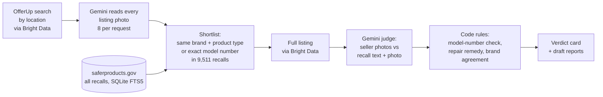

# RecallRadar

**Recalled products are for sale near you right now, and we find them.**

RecallRadar sweeps every resale listing in an area (OfferUp, through Bright Data), reads each seller's photo with Gemini,
and checks it against all 9,511 U.S. Consumer Product Safety Commission recall records. Every verdict shows its evidence:
the seller's photo next to the recalled product's photo, the exact words or label that matched, and links to both.

Built at SanD Hacks 2026 (UCSD) for the Bright Data "Data for Good" track.

## How it works



| Stage | What | Why |
|---|---|---|
| 1. Search | OfferUp's own search API, any lat/long and radius | Covers every listing for a set of queries, not just suspicious ones |
| Bright Data | All OfferUp requests go through Web Unlocker | OfferUp blocked our IP after a few hundred requests during development. A sweep is hundreds of requests. |
| 2. Read photos | Gemini flash-lite, 8 thumbnails per request | Sellers write "Newborn Bed", not "Fisher-Price Rock 'n Play". The brand is on the photo. |
| 3. Shortlist | SQLite full-text search: recalls naming that brand + sharing a product word, or an exact model number | Cuts ~500 listings to ~30 worth a careful look |
| 4. Judge | Gemini compares up to 3 seller photos with up to 3 candidate recalls (text + photo) | Returns verdict, reason, quoted evidence |
| 5. Rules | Plain code, not the model | Model numbers are checked against the recall's list; "recalled" needs agreeing brands and a named product; repair remedies cap at "closer look" |

### Verdicts

- **Matches a recall**: the listing shows a recalled product by name, label or model (or the recall covers all models).
- **Needs a closer look**: brand and product match but no model is visible, or the recall's fix is a repair that may already be done.
- **Cleared**: same brand, but the listing shows a model the recall does not include.

## Run it

```bash
uv venv -p 3.12 .venv && uv pip install -p .venv -r requirements.txt
cp .env.example .env          # add GEMINI_API_KEY; Bright Data key comes from the CLI login or BRIGHTDATA_API_KEY
.venv/bin/python -m recallradar.recalls        # build the recall index (~10 s)
.venv/bin/uvicorn recallradar.app:app --port 8000
```

Checks:

```bash
.venv/bin/python scripts/known8.py         # fetch the 8 hand-verified listings
.venv/bin/python scripts/check_vision.py   # full matcher on them, expected verdicts
.venv/bin/python -m recallradar.sweep infant_sleep   # one sweep from the command line
```

## Honest limits

- A verdict is an automated reading of a photo, not an inspection. Cards say "matches a recalled product", never accuse the seller.
- Precision is measured, not assumed: see `docs/evaluation.md`.
- Listings sell and disappear; past sweeps are stored and can be replayed.
