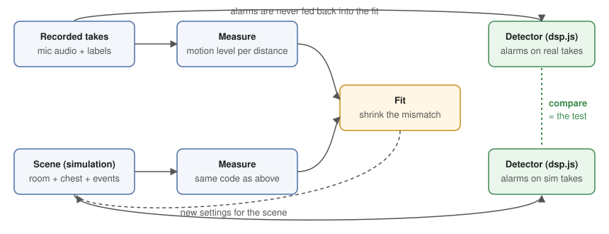

# Calibrated simulation: what it is, what it shows, what it cannot show

State: 2026-11-14 night, detector at commit `25b3807`. One person, one MacBook, 19 recorded takes (about 65 min).

## The system in one paragraph

Recorded takes are measured (motion level per distance slice, per speed band, per label). A simulated scene
(room + chest + events) is measured the same way, and its settings are changed until the two tables agree.
The detector's alarms are never part of that loop. The test is separate: run the live detector on the recording
and on simulated twins and compare the alarms. If the twins alarm like the recording, the simulation can stand
in for recordings. If not, it cannot.

## Result: the simulation does NOT yet stand in for recordings

`node tools/fit/validate.js 12` (five clean guided takes, 12 twins each):

| Check | Recordings | Simulated twins |
|---|---|---|
| Echo motion levels (what was fitted) | | 3-5.5 dB rms off |
| Holds caught, holds the fit never measured (held out) | 10 of 10 | 33% of 120 |
| Holds caught, each take predicted from the other four | 13 of 16 | 44% of 192 |
| Watched distance within 6 cm of the recording | | 43% of twins |
| Time to alarm when caught | about 7 s | off by about 5 s (median) |
| False alarms per minute | 0.12 | 0.13 |

Agrees: false alarm rate, missed holds before lock-on. Disagrees: how often a hold is caught, where it locks.
So: no accuracy number from this simulation may be quoted. Seven fit rounds, each changed for a stated reason
(see "Rounds"); the gap did not close.

Why, as far as measured (`node tools/fit/hold-shape.js`): in recordings the detector's level falls 7-8 dB within
6-8 s of the hold label. In twins it falls 3-4 dB. Matching each state's median level is not enough. What the
recordings have and the model lacks is not identified yet. Candidates, untested: a deeper breath just before a
guided hold, the person freezing more over the hold, motion that is correlated across neighbouring slices.

## What the loop found in the recordings (these stand without the simulation)

| # | Finding | Evidence | Status |
|---|---|---|---|
| 1 | The app said "Watching" with no probe sound in the mic (speaker muted). A 27 s hold raised no alarm. | take `05-44-51`: probe -2 dB, all others 32-72 dB | Fixed: status "Can't hear my own sound". `node tools/fit/check-deaf.js` |
| 2 | One silent mic frame turned the running signal strength into NaN for good. | `cir()` returned -Infinity | Fixed in `dsp.js` |
| 3 | App played the probe at 0.7 and carried 17 dB more audible sound (16-19.5 kHz) than recorder takes at 0.15, same probe level in the mic. | spectrum of 3 recorder and 2 app takes | Changed: loudness sets itself at start. Not tried live |
| 4 | Holds that start before lock-on (32 s) are always missed. After lock-on, clean guided takes: 13 of 14 caught. | `node tools/fit/baseline.js`, `holds.js` | Demo rule: hold only after "Watching" |
| 5 | Hand-pressed labels have the hand in the echo: 28-42 dB burst at 6-29 cm around the mark. Guided takes do not. | `node tools/fit/keypress.js` | Use guided takes for measuring |
| 6 | Take `23-20-21` has 125 audio dropouts (20 dB one-second spikes). | take metadata `xruns`, `keypress.js` | Leave out of tuning |
| 7 | The breaths-per-minute number reads about 4/min on most takes while breathing normally. | detector trace on 6 takes | Do not show or claim a rate |
| 8 | The uncommitted "pick the closest slice" version at 22:12 cut caught holds from 17 of 27 to 12 of 27. The committed version `25b3807` gets 20 of 30. | replay of three detector versions | Resolved by `25b3807` |

## What we can do now

- Replay any detector change on all takes in 15 s: `node tools/fit/baseline.js` (holds caught, time to alarm, false alarms, lock distance per take). Compare versions: `DSP=/path/to/other-dsp.js node tools/fit/baseline.js`.
- Per hold, see whether the drop is visible at any distance: `node tools/fit/holds.js`.
- Check a take for no-signal, dropouts, hand bursts before trusting it.
- Use the simulation for plumbing only: does an alarm fire at all on an ideal scene, does a new status or guard behave, timing of lock-on.
- State with evidence: 20 of 30 labeled holds caught on recordings; 13 of 14 after lock-on on clean guided takes; about 7 s to alarm; false alarms about 0.12 per minute sitting still.

## What needs more data (and which recording answers it)

| Question | Why current data cannot answer | Recording needed |
|---|---|---|
| Does it work on another person or laptop? | 1 person, 1 MacBook | 3+ people, 2+ laptops, guided plan `normal 60, hold 20, x4` |
| Noisy hall, people walking past? | all takes in quiet rooms | same plan at the venue, with a walker at 1 m and 2 m |
| What separates a caught hold from a missed one after lock-on? | 1 unexplained miss on clean takes, more on messy ones | 20+ guided holds of 20 s, hold starting after 60 s, hands in lap |
| Is a hold seen as "breathing stopped" or as "body froze"? | every hold so far is also a freeze | holds while slightly fidgeting (the new `fidget` label), and stillness while breathing shallowly |
| Slow breathing (the overdose pattern)? | no slow-breathing take exists | paced takes at 6 and 4 breaths/min |
| Real hold after moving back? | no take has one | `normal 60, moving 10, normal 45, hold 20` |
| Sleep, lying down, real overdose | never recorded | out of reach for this weekend. Say so |
| Why twins miss holds that recordings catch | model lacks something not yet named | the 20+ guided holds above, with a mark at the last breath |

## Rounds (what changed and why)

| Round | Change | Reason | Held-out holds caught by twins |
|---|---|---|---|
| 1 | point reflectors + empty-room background | first model | 33% (no split yet) |
| 2 | added the detector's rhythm score per slice to the target | twins locked at 46-114 cm, real 23-34 | 40% |
| 3 | background = each take's own hold levels, breathing added on top | shared body sway kept the chest noisy in holds | 46% |
| 4 | train/test split inside takes, leave-one-take-out; sway stops in holds | fit and test used the same audio | 33% |
| 5 | hold levels measured from 5 s after the label | first seconds still contain a breath | 33% |
| 6 | slow swings in level | real levels swing 10 dB, twins 6 | 37% |
| 7 | measured normal-time extra motion per slice | point reflectors could not fill all slices | 33% |

## Files

- `tools/fit/takes.js` loads takes, caches echo profiles, runs the detector. `measure.js`, `bands.js` measure.
- `scene.js` is the simulator (`check-scene.js` proves it equals the audio path). `fit.js` fits, `validate.js` tests.
- `holds.js`, `hold-shape.js`, `keypress.js`, `baseline.js`, `check-deaf.js`, `compare.js` are the diagnostics above.
- `docs/sim/measured.json`, `fitted.json`, `validation.json`, `baseline.json` are their outputs.

## Assumptions

- Hold labels are when the banner changed, not when breathing stopped.
- Non-breathing motion is the same in holds and in normal breathing (round 3). Round 4 showed this is doubtful.
- Background fluctuation is independent between slices. Real slices are correlated.
- Five takes, one sitting each. A fit to five takes of one person is a description, not a model of people.
